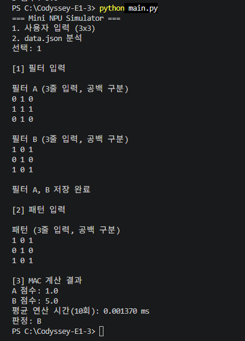
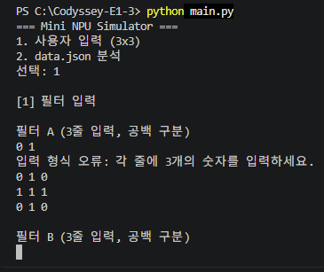
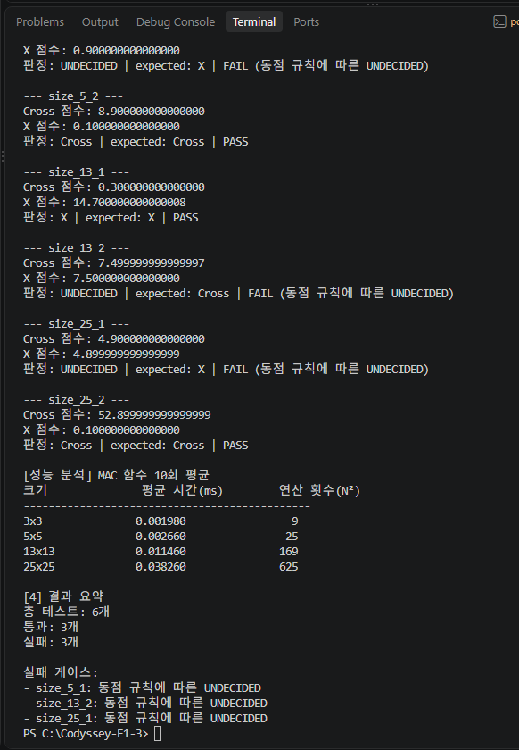
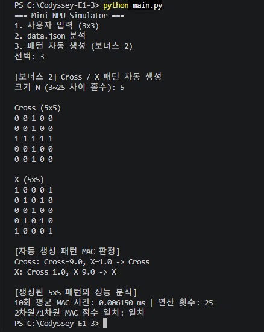
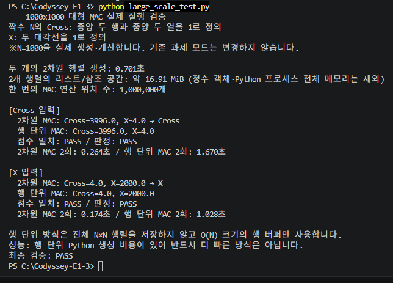

# Codyssey E1-3 \| Mini NPU Simulator

> **주제:** AI가 계산하는 방식을 흉내 내는 작은 계산기 만들기\
> **개발 언어:** Python 3.8 이상\
> **외부 라이브러리:** 사용하지 않음 (Python 표준 라이브러리 사용)

## 1. 프로젝트 소개

이번 과제에서는 AI가 숫자를 계산하는 기본 방식을 이해하기 위해 **Mini
NPU Simulator**를 만들었습니다.

그림을 숫자가 들어 있는 표(N×N 배열)로 나타내고, 입력된 패턴이
**Cross(십자가)** 모양인지 **X** 모양인지 비교하는 프로그램입니다.

**MAC(Multiply-Accumulate)** 은 같은 위치의 숫자를 곱하고 그 결과를 모두
더하는 연산입니다. 두 필터의 점수를 비교해 높은 쪽을 선택하고, 점수가
거의 같으면 판정을 보류합니다.

이번 실습에서 확인한 내용입니다.

-   반복문을 이용한 MAC 계산
-   JSON 데이터 로드 및 입력 검증
-   EPSILON을 이용한 동점 처리
-   크기별 연산 시간 비교
-   2차원 배열과 1차원 배열 비교
-   Cross/X 패턴 자동 생성
-   1000×1000 대규모 연산 및 추가 성능 비교

## 2. 프로젝트 구성 및 실행

### 2.1 파일 구성

``` text
Codyssey-E1-3/
├── main.py                     # 메인 프로그램
├── large_scale_test.py         # 1000×1000 대규모 연산 실험
├── data.json                   # 테스트 데이터
├── README.md                   # 프로젝트 설명 및 결과
└── screenshots/
    ├── 01_mac_result.png
    ├── 02_input_validation.png
    ├── 03_json_performance.png
    ├── 04_bonus_pattern.png
    └── 05_large_scale_test.png
```

추가 연습 코드는 별도 저장소에서 관리합니다.

-   [Codyssey-E1-3-Practice](https://github.com/haru1208/Codyssey-E1-3-Practice)

### 2.2 실행 방법

기본 프로그램:

``` bash
python main.py
```

1000×1000 대규모 연산:

``` bash
python large_scale_test.py
```

### 2.3 프로그램 메뉴

  모드   기능
  ------ -----------------------------------
  1      사용자 입력 (3×3)
  2      data.json 분석
  3      Cross/X 패턴 자동 생성 (보너스 2)

## 3. 핵심 기능 구현

### 3.1 MAC 연산과 사용자 입력

`mac(pattern, filter_data)` 함수는 이중 반복문을 사용합니다.

-   행과 열을 순서대로 이동합니다.
-   같은 위치의 숫자를 곱합니다.
-   계산 결과를 계속 더합니다.
-   모든 위치를 계산하면 최종 점수를 반환합니다.

`mac()`의 반환값은 실수형(float)입니다. 입력값이 실수인 경우에도 계산할
수 있습니다.

### 3.1.1 모드 1: 3×3 입력 및 결과 확인

이번 실행에서는 동점 처리를 확인하기 위해 필터 A와 필터 B에 같은 Cross
패턴을 입력하고, 입력 패턴도 Cross로 설정했습니다.

**입력 예시**

``` text
필터 A
0 1 0
1 1 1
0 1 0

필터 B
0 1 0
1 1 1
0 1 0

패턴
0 1 0
1 1 1
0 1 0
```

**실행 결과**

``` text
[3] 3x3 입력·MAC 계산 통합 결과

입력 필터: A(3x3), B(3x3) - 총 2개
A 점수: 5.0
B 점수: 5.0
점수 차이: 0
평균 연산 시간(각 1000회, 단위 ms): 0.001252 ms
판정: 판정 불가 (|A-B| < 1e-09)
```

두 필터의 점수가 같으므로 어느 쪽이 더 높은지 결정하지 않고 **판정
불가**로 표시합니다. 내부 판정값은 `UNDECIDED`입니다.



### 3.2 사용자 입력 검증

3×3 입력에서는 각 행에 숫자가 정확히 3개 있어야 합니다.

-   행의 숫자 개수가 맞지 않는 경우
-   숫자로 변환할 수 없는 값이 입력된 경우
-   NaN 및 무한대 등 유효하지 않은 숫자가 입력된 경우

잘못된 입력은 안내 문구를 출력하고 다시 입력받습니다.



### 3.3 JSON 분석 및 라벨 정규화

`data.json`에는 크기별 필터와 패턴이 저장되어 있습니다.

  구분       데이터
  ---------- --------------------------
  필터       size_5, size_13, size_25
  패턴       size_N_idx 형태
  expected   예상 정답 라벨

예를 들어 `size_13_1`이라는 패턴 이름에서 13을 추출하여 `size_13` 필터를
선택합니다.

**라벨 정규화**

JSON에 서로 다른 이름으로 저장된 라벨을 프로그램 내부에서 두 가지로
통일합니다.

  입력                    표준 라벨
  ----------------------- -----------
  `+`, `cross`, `Cross`   Cross
  `x`, `X`                X

`normalize_label()` 함수에서 대소문자를 구분하지 않고 표준 라벨로
변환합니다. 등록되지 않은 라벨은 오류로 처리합니다.

필터가 누락되거나 패턴의 크기가 맞지 않는 경우 해당 케이스를 FAIL
처리하고 다음 케이스를 계속 분석합니다.

### 3.3.1 JSON 데이터 선택 과정

JSON 분석은 다음 순서로 진행합니다.

1.  `data.json` 파일을 읽습니다.
2.  `size_5`, `size_13`, `size_25` 필터를 먼저 불러오고 크기와 라벨을
    확인합니다.
3.  패턴 키에서 N을 추출합니다.
4.  해당 크기의 Cross/X 필터를 선택해 MAC 연산을 수행합니다.

**실행 로그 예시**

``` text
[1] JSON 데이터 로드
JSON 로드 완료: filters=3개 크기, patterns=6개 케이스

[2] 필터 로드 및 검증
✓ size_5 필터 로드 완료 (Cross, X)
✓ size_13 필터 로드 완료 (Cross, X)
✓ size_25 필터 로드 완료 (Cross, X)

[3] 패턴 자동 분석
JSON 선택 로그:
patterns[size_5_1] -> N=5 ->
filters[size_5] -> Cross/X 필터 선택 완료
```



### 3.4 EPSILON과 UNDECIDED

컴퓨터는 소수점을 계산할 때 아주 작은 오차가 발생할 수 있습니다.

이를 고려하기 위해 `EPSILON`이라는 허용오차를 사용합니다.

``` python
EPSILON = 1e-9
```

두 점수의 차이가 `1e-9`보다 작으면 동점으로 처리합니다.

``` python
if abs(score_a - score_b) < EPSILON:
    return "UNDECIDED"
```

**UNDECIDED는 어느 한쪽이 확실히 우세하지 않아 판정을 보류한다는
뜻입니다.**

모드 1에서는 사용자에게 `판정 불가`라고 표시하고, 모드 2에서는
`UNDECIDED`로 표시합니다. 내부 판정 기준은 두 모드 모두 같습니다.

EPSILON을 크게 설정하면 더 많은 점수가 동점으로 처리되고, 작게 설정하면
작은 차이도 승패를 결정하게 됩니다.

### 3.5 모드 1과 모드 2의 동점 처리 차이

두 모드 모두 동일한 EPSILON 기준으로 동점을 판단합니다. 다만 PASS/FAIL을
처리하는 방식이 다릅니다.

  구분            모드 1          모드 2
  --------------- --------------- --------------------------
  비교 대상       필터 A와 B      Cross와 X
  동점 결과       판정 불가       UNDECIDED
  expected 비교   없음            있음
  PASS/FAIL       집계하지 않음   expected와 비교하여 집계

모드 1은 사용자가 직접 입력하는 방식이므로 정답 라벨이 따로 없습니다.

반면 모드 2는 JSON에 expected가 저장되어 있으므로 실제 판정과
비교합니다.

따라서 UNDECIDED가 나오더라도 프로그램 오류는 아니지만, expected와
일치하지 않으면 FAIL이 될 수 있습니다.

## 4. 실제 실행 및 검증 결과

### 4.1 JSON 데이터 분석 결과

원본 `data.json`의 6개 케이스를 실행한 결과입니다.

  케이스      판정        expected   결과
  ----------- ----------- ---------- ------
  size_5_1    UNDECIDED   X          FAIL
  size_5_2    Cross       Cross      PASS
  size_13_1   X           X          PASS
  size_13_2   UNDECIDED   Cross      FAIL
  size_25_1   UNDECIDED   X          FAIL
  size_25_2   Cross       Cross      PASS

**전체 결과**

  항목            개수
  ------------- ------
  전체 테스트        6
  PASS               3
  FAIL               3

세 FAIL은 프로그램이 비정상적으로 종료되었다는 뜻이 아닙니다. 두 필터의
점수 차이가 EPSILON보다 작아 UNDECIDED가 나왔고, JSON의 expected와
일치하지 않아 FAIL로 기록된 것입니다.

**FAIL이라고 해서 무조건 프로그램에 오류가 있다는 뜻은 아닙니다.**

### 4.2 크기별 MAC 성능 분석

각 크기에서 MAC 함수를 1,000회 반복 측정하고 평균 시간을 계산했습니다.
측정 전에 1회 워밍업을 수행했으며, 워밍업 시간은 평균에서 제외했습니다.

  패턴 크기     평균 시간(ms)   연산 횟수(N²)
  ----------- --------------- ---------------
  3×3                0.001353               9
  5×5                0.002247              25
  13×13              0.012319             169
  25×25              0.040967             625

크기가 커질수록 한 번의 MAC 연산에서 확인하는 위치 수와 측정 시간이 함께
증가했습니다. 다만 실제 시간은 컴퓨터 상태와 실행 환경에 따라 달라질 수
있습니다.

### 4.3 의도적인 데이터 오류 테스트

원본 JSON을 보존하고 테스트용 복사본에서 일부 행의 숫자 개수를
변경했습니다.

-   정상적인 5개 숫자를 4개로 변경
-   프로그램에서 크기 오류 감지
-   해당 케이스 FAIL 처리
-   나머지 케이스 분석 계속 진행

이 과정을 통해 데이터 오류가 발생해도 프로그램 전체가 중단되지 않는 것을
확인했습니다.

## 5. 보너스 과제

### 5.1 보너스 1 --- 2차원 배열과 1차원 배열 비교

기존 2차원 배열을 1차원 배열로 변환하여 MAC 연산을 수행했습니다.

관련 함수:

-   `flatten_matrix()`: 2차원 배열을 1차원 배열로 변환
-   `mac_flat()`: 1차원 배열을 이용한 MAC 계산

동일한 입력을 사용해 각 방식으로 1,000회 계산하고 평균 시간을
비교했습니다. 배열 변환 시간은 MAC 측정에서 제외했으며, 각 방식의 첫
호출은 워밍업으로 제외했습니다.

  크기      2차원 배열(ms)   1차원 배열(ms) 점수
  ------- ---------------- ---------------- ------
  3×3             0.001302         0.000783 일치
  5×5             0.003096         0.001264 일치
  13×13           0.011177         0.007452 일치
  25×25           0.037924         0.031321 일치

이번 측정에서는 네 가지 크기 모두 1차원 배열의 계산 시간이 짧게
나왔습니다. 다만 한 번의 측정 결과만으로 1차원 배열이 항상 빠르다고 결론
내릴 수는 없습니다. 데이터 생성과 접근 방식, 실행 환경에 따라 결과가
달라질 수 있습니다.

### 5.2 보너스 2 --- Cross/X 패턴 자동 생성

원하는 크기를 입력하면 Cross와 X 패턴을 자동으로 생성하도록
구현했습니다.

-   Cross: 중앙 행과 중앙 열을 1로 설정
-   X: 두 대각선을 1로 설정

현재 기본 생성기는 3\~25 사이의 홀수 크기를 지원합니다.

5×5 패턴을 생성하여 MAC 계산을 수행한 결과입니다.

  입력 패턴     Cross 필터 점수   X 필터 점수 판정
  ----------- ----------------- ------------- -------
  Cross                     9.0           1.0 Cross
  X                         1.0           9.0 X

생성된 패턴은 자기 모양의 필터에서 더 높은 점수를 얻었습니다. 5×5 MAC
연산은 1,000회 평균 0.002809ms였으며, 연산 위치는 25개입니다. 실행
화면에서 2차원과 1차원 MAC 점수도 일치하는 것을 확인했습니다.



## 6. 결과 리포트 --- 실패 원인 및 시간 복잡도 분석

### 6.1 실패 원인 분석

1.  원본 JSON 데이터로 총 6개 케이스를 실행해 PASS 3개, FAIL 3개를
    확인했습니다.
2.  실패한 케이스는 `size_5_1`, `size_13_2`, `size_25_1`입니다.
3.  세 케이스 모두 두 필터의 점수 차이가 설정된 허용오차 `1e-9`보다
    작았습니다.
4.  따라서 프로그램은 세 케이스를 `UNDECIDED`로 판정했습니다.
5.  각 케이스의 `expected`는 X 또는 Cross이므로 `UNDECIDED`와 일치하지
    않아 FAIL로 기록되었습니다.
6.  이 FAIL들은 JSON 파싱 실패나 MAC 함수의 예외가 아니라 수치 비교
    정책에 따른 판정 결과입니다.

**실제 점수와 차이**

  -----------------------------------------------------------------------------
  케이스                  Cross 점수              X 점수              점수 차이
  -------------- ------------------- ------------------- ----------------------
  size_5_1         0.900000000000000   0.900000000000000   1.11022302462516e-16

  size_13_2        7.499999999999997   7.500000000000000   2.66453525910038e-15

  size_25_1        4.900000000000000   4.899999999999999   1.77635683940025e-15
  -----------------------------------------------------------------------------

세 점수 차이는 모두 `1e-9`보다 작으므로 동점 처리 기준에 해당합니다.

7.  `+`를 Cross로, `x`를 X로 바꾸는 라벨 정규화를 구현해 표현 차이에
    따른 잘못된 비교를 방지했습니다.
8.  별도 복사본의 5×5 행 길이를 4로 줄인 테스트에서는 크기 오류를
    감지했습니다.
9.  이 경우 해당 항목만 FAIL 처리되고 나머지 분석은 계속되었습니다.
10. 따라서 실패 원인을 데이터·스키마 문제와 판정 정책 문제로 구분하여
    확인할 수 있었습니다.
11. 정확성을 위해 expected 값을 바꾸거나 동점 케이스를 임의로 PASS
    처리하지 않았습니다.

### 6.2 시간 복잡도 분석

1.  한 번의 MAC 연산에는 행 반복문과 열 반복문이 사용됩니다.
2.  각 행의 N개 위치를 N행에 걸쳐 검사하므로 위치별 곱셈은 N×N번
    발생합니다.
3.  따라서 한 필터에 대한 MAC 연산의 시간 복잡도는 **O(N²)** 입니다.
4.  N=3, 5, 13, 25일 때 곱셈 횟수는 각각 9, 25, 169, 625회입니다.
5.  5×5에서 25×25로 커지면 연산 횟수는 25배가 됩니다.
6.  같은 구간의 측정 시간은 0.002247ms에서 0.040967ms로 약 18.23배
    증가했습니다.
7.  측정 시간이 연산 횟수와 정확히 같은 비율로 증가하지는 않았습니다.
    함수 호출 비용과 실행 환경 등의 영향이 있기 때문입니다.
8.  1차원 배열로 바꾸더라도 계산해야 하는 숫자의 개수는 같으므로 시간
    복잡도는 O(N²)로 유지됩니다.
9.  배열 변환 시간은 별도로 측정에서 제외했습니다.
10. 따라서 배열 구조에 따른 실행 시간 차이는 실제 측정으로 비교하되,
    연산량 자체는 N²로 설명할 수 있습니다.

### 6.3 1000×1000 대규모 연산 실습

기존 `main.py`는 수정하지 않고 별도 파일인 `large_scale_test.py`를
이용해 1000×1000 데이터를 실제로 생성하고 계산했습니다.

**실행 명령어**

``` powershell
python large_scale_test.py
```

1000은 짝수이므로 Cross는 중앙 두 행과 중앙 두 열을 1로 설정했습니다.
X는 두 대각선을 1로 설정했습니다.

#### 6.3.1 데이터 생성 및 메모리

  항목                            결과
  --------------------- --------------
  행렬 크기                  1000×1000
  생성 행렬                        2개
  생성 시간                    0.617초
  리스트 및 참조 공간     약 16.91 MiB
  MAC 1회 연산 위치        1,000,000개

16.91 MiB는 리스트 객체와 원소 참조 공간을 기준으로 한 값이며, 정수
객체와 Python 프로세스 전체 메모리는 포함하지 않습니다.

#### 6.3.2 실제 실행 결과

**Cross 입력**

  방식           Cross 점수   X 점수   실행 시간
  ------------ ------------ -------- -----------
  2차원 배열         3996.0      4.0     0.186초
  행 단위            3996.0      4.0     2.137초

**X 입력**

  방식           Cross 점수   X 점수   실행 시간
  ------------ ------------ -------- -----------
  2차원 배열            4.0   2000.0     0.184초
  행 단위               4.0   2000.0     1.166초

두 방식 모두 동일한 점수와 판정 결과를 반환했습니다.

다만 행 단위 방식은 데이터를 매번 생성하는 Python 코드의 실행 비용이
추가되어 더 느리게 측정됐습니다.



#### 6.3.3 계산 결과 이해하기

1000×1000에서 Cross는 중앙 두 행과 두 열을 1로 설정합니다.

``` text
중앙 두 행: 2 × 1000 = 2000
중앙 두 열: 2 × 1000 = 2000

중앙 교차 중복 4개 제외

2000 + 2000 - 4 = 3996
```

따라서 Cross 입력과 Cross 필터의 점수는 3996입니다.

X는 두 대각선에 각각 1000개씩 1이 있으므로 점수는 2000입니다.

서로 다른 패턴끼리 비교하면 두 패턴이 겹치는 위치인 4개만 점수에
반영됩니다.

#### 6.3.4 대규모 연산에서 확인한 점

-   **연산량:** 1000×1000은 한 번 계산할 때 100만 개의 위치를
    확인합니다.
-   **메모리:** 전체 배열을 미리 생성하면 데이터를 저장할 공간이
    필요합니다.
-   **행 단위 처리:** 전체 데이터를 미리 만들지 않고 한 줄씩 계산할 수
    있습니다.
-   **속도:** 행 단위 방식은 메모리 사용을 줄일 수 있지만, 행을 생성하는
    시간 때문에 반드시 빠른 것은 아닙니다.

이번 실험은 전체 행렬을 비교용으로 보유한 상태에서 행 단위 계산을
수행했습니다. 따라서 전체 프로그램의 메모리가 O(N)으로 줄어든 실험은
아닙니다.

#### 6.3.5 추가 연습 --- 1차원 배열을 적용한 대규모 연산

보너스 1에서 배운 1차원 배열 방식을 1000×1000 행 단위 실험에도 적용해
보았습니다.

추가 실험 코드는 별도 저장소에서 관리합니다.

**[Codyssey-E1-3-Practice](https://github.com/haru1208/Codyssey-E1-3-Practice)**

실행 파일:

``` bash
python large_scale_1d_test.py
```

이번에는 네 가지 방식을 비교했습니다.

  방식              설명
  ----------------- -------------------------------------------
  2차원 전체 배열   전체 데이터를 2차원 배열로 생성
  1차원 전체 배열   전체 데이터를 한 줄로 펼쳐서 생성
  2차원 행 단위     입력을 한 행씩 생성하여 계산
  1차원 행 단위     한 행씩 생성하고 1차원 인덱스로 필터 접근

**계산 결과**

네 가지 방식 모두 동일한 MAC 점수를 반환했습니다.

  입력 패턴     Cross 필터   X 필터
  ----------- ------------ --------
  Cross               3996        4
  X                      4     2000

**실행 시간 비교**

각 방식은 7회 측정했으며, 아래는 중앙값입니다.

단위: 초(second)

  입력      2차원 전체   1차원 전체   2차원 행 단위   1차원 행 단위
  ------- ------------ ------------ --------------- ---------------
  Cross       0.114473     0.082979        0.274711        0.277260
  X           0.125704     0.090554        0.239732        0.241424

**결과 해석**

-   전체 배열 방식에서는 1차원 배열이 더 빠르게 측정됐습니다.
-   행 단위 방식에서는 1차원 배열이 오히려 조금 느렸습니다.
-   네 가지 방식 모두 계산 결과는 일치했습니다.
-   따라서 1차원 배열이 항상 빠른 것은 아니며, 데이터를 생성하고
    접근하는 방식에 따라 결과가 달라집니다.

전체 배열 방식은 배열 생성이 끝난 뒤 MAC 계산만 측정했습니다. 행 단위
방식은 각 행을 생성하는 시간도 포함합니다.

### 6.4 CPU와 NPU는 무엇이 다를까?

이번 프로그램은 CPU에서 실행한 Python 실습입니다. 실제 NPU를 연결해서
측정한 것은 아닙니다.

  -----------------------------------------------------------------------
  구분                    CPU                     NPU
  ----------------------- ----------------------- -----------------------
  처리 방식               범용 작업을 처리        AI 연산에 특화

  계산 방식               다양한 명령과 연산 처리 많은 MAC 연산을 병렬
                                                  처리하도록 설계

  장점                    다양한 작업에 유연하게  대량의 AI 연산을
                          대응                    효율적으로 처리하도록
                                                  설계

  병목                    반복문 실행 비용과      메모리 대역폭과 데이터
                          메모리 접근             이동
  -----------------------------------------------------------------------

여기서 **병목**은 전체 속도를 느리게 만드는 구간이라는 뜻입니다. 계산
장치가 아무리 빨라도 메모리에서 데이터를 늦게 가져오면 기다리는 시간이
생깁니다.

이번 실습에서는 CPU로 1000×1000 계산을 직접 측정했지만, NPU의 속도나
전력은 측정하지 않았습니다.

## 7. 결과 정리

이번 과제에서는 3×3 기본 MAC 계산부터 JSON 분석, 성능 측정, 보너스
과제까지 수행했습니다. 이후 1000×1000 데이터로 2차원 배열, 1차원 배열,
행 단위 처리의 계산 결과와 실행 시간을 비교했습니다.

이번 실습에서 확인한 내용은 다음과 같습니다.

1.  MAC 연산은 같은 위치의 값을 곱하고 누적해서 더하는 방식입니다.
2.  EPSILON은 소수점 계산의 작은 차이를 동점으로 처리하기 위한
    기준입니다.
3.  UNDECIDED는 승자를 정하지 않고 판정을 보류한다는 의미입니다.
4.  FAIL은 반드시 프로그램 오류를 뜻하지 않으며, expected와 실제 판정이
    다를 때도 발생합니다.
5.  배열을 2차원에서 1차원으로 바꿔도 계산해야 하는 데이터의 개수는 같기 때문에 연산량은 N²로 유지됩니다.
6.  1차원 배열이 항상 빠른 것은 아니며, 데이터 생성 및 접근 방식에 따라
    결과가 달라집니다.
7.  행 단위로 계산하면 전체 데이터를 미리 저장하지 않아 메모리를 줄일 수 있지만, 매번 새로운 행을 만드는 과정에서 추가 시간이 발생할 수 있습니다.


기본 과제와 추가 실습을 각각 별도 GitHub 저장소로 관리했으며, 실제 실행
결과를 확인하면서 배열 구조와 계산 방식에 따른 차이를 공부했습니다.
